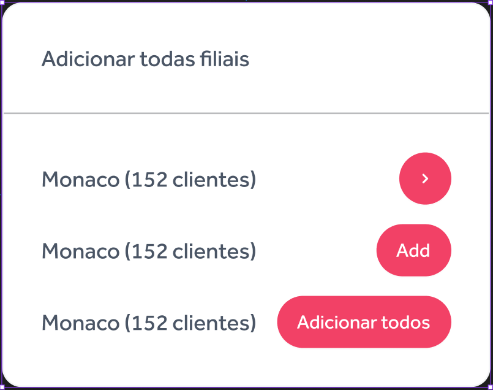
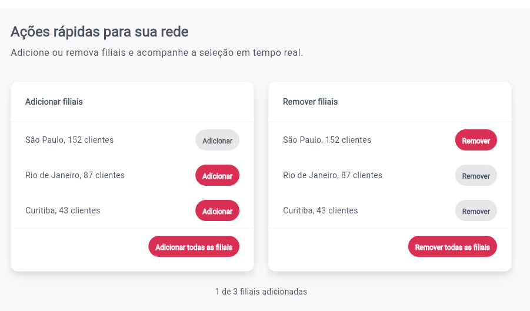
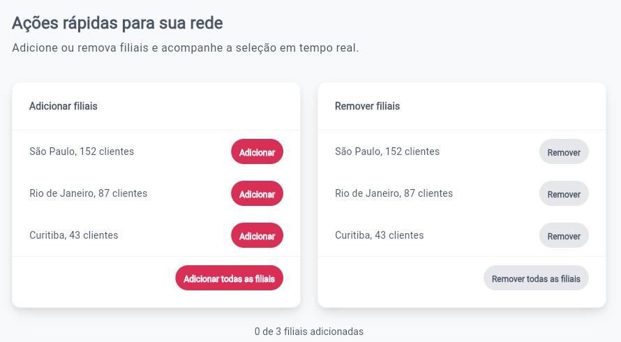
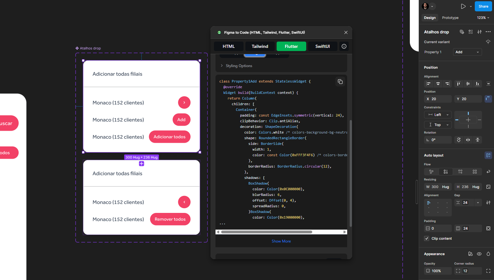

# Atalhos de Filiais — Flutter Design System

**Do Figma à engenharia de interfaces:** um componente Flutter reutilizável, com Material 3, arquitetura orientada à composição, estados controlados e testes automatizados.

[**Demonstração interativa**](https://allanfagiani-oss.github.io/flutter-branch-shortcuts-design-system/) · [**Código-fonte**](https://github.com/allanfagiani-oss/flutter-branch-shortcuts-design-system) · [**Pipeline de CI/CD**](https://github.com/allanfagiani-oss/flutter-branch-shortcuts-design-system/actions)

[](https://github.com/allanfagiani-oss/flutter-branch-shortcuts-design-system/actions/workflows/deploy.yml)

## Visão geral

O **Branch Shortcuts** é um componente de interface que exibe filiais e permite executar ações individuais ou em lote para adicioná-las ou removê-las de uma seleção.

O projeto surgiu da exportação de uma interface criada no Figma. Em vez de utilizar o código gerado automaticamente como implementação final, o componente foi reorganizado para demonstrar práticas de **UI Engineering**: contratos tipados, separação de responsabilidades, tematização, interação acessível e validação automatizada.

A aplicação web é uma **demonstração**, com dados e estado locais; o componente reutilizável não implementa regras de persistência ou integração com backend.

## Experimente

**[Abrir o componente no navegador →](https://allanfagiani-oss.github.io/flutter-branch-shortcuts-design-system/)**

Na demonstração, é possível testar as variantes **Adicionar** e **Remover**, as ações individuais e coletivas, os estados habilitado/desabilitado e a atualização da contagem de filiais selecionadas.


## Do Figma ao Flutter

### 01. Referência original

O componente foi inicialmente projetado no Figma, com variantes e propriedades visuais definidas.



### 02. Implementação Flutter

O componente foi reconstruído utilizando Material 3, tokens semânticos, callbacks tipados e estado controlado pelo componente pai.



### 03. Estados de interação

As ações individuais e coletivas são habilitadas ou desabilitadas conforme a seleção atual.



### Referência visual



A referência apresenta o painel com as opções já visíveis. Por isso, a implementação não inventa abertura/fechamento ou um overlay; o termo *dropdown* foi preservado na API por continuidade com a nomenclatura do projeto.

## Tecnologias e práticas

- **Flutter e Dart:** implementação do componente e da demonstração web.
- **Material 3:** controles interativos e integração ao sistema de temas.
- **`ThemeExtension`:** tokens para superfícies, cores, espaçamentos, bordas, raios e sombras.
- **Atomic Design:** composição de linha de filial, painel e demonstração, sem abstrações artificiais.
- **`flutter_test`:** 15 testes de widget para contratos de interação, responsividade e acessibilidade.
- **GitHub Actions e GitHub Pages:** análise estática, testes, build web e deploy automatizados.

## Desafio: da exportação à arquitetura

| Código exportado do Figma | Componente refatorado |
| --- | --- |
| Textos, dados e medidas fixos | Dados externos e tokens de tema |
| Estrutura extensa e repetitiva de widgets | Composição com responsabilidades definidas |
| Sem contrato de seleção e ações para o consumidor | API tipada com callbacks e estado controlado pelo pai |
| Representação predominantemente visual | Interações, semântica, foco e estados desabilitados |
| Sem validação automatizada demonstrada | 15 widget tests e pipeline de CI/CD |

A proposta não é reproduzir mecanicamente cada linha da exportação, mas preservar suas decisões visuais relevantes e transformar o resultado em uma interface sustentável.

## Arquitetura

```text
lib/
├── branch_shortcuts.dart                 # API pública
├── main.dart                             # Entrada da aplicação
└── src/
    ├── component/
    │   └── branch_shortcuts_dropdown.dart
    ├── demo/
    │   └── branch_shortcuts_demo.dart
    ├── model/
    │   └── branch_shortcut.dart
    └── theme/
        ├── design_system_theme.dart
        └── shortcut_tokens.dart

test/
└── branch_shortcuts_dropdown_test.dart

reference/
├── figma_export.txt
└── atalhos-figma.png.png

.github/workflows/
└── deploy.yml
```

### Decisões de engenharia

**Estado controlado pelo componente pai.** `BranchShortcutsDropdown` é responsável pela apresentação. Recebe `branches` e `selectedBranchIds`, comunica intenções por callbacks e não altera diretamente a seleção.

**Contratos explícitos.** `BranchShortcut` modela os dados de exibição. `BranchShortcutVariant` e `BranchAction` representam as variantes e ações com tipos, reduzindo dependência de strings e condições implícitas.

**Elegibilidade derivada do estado.** Na variante de adição, filiais já selecionadas não podem ser adicionadas novamente; na de remoção, filiais não selecionadas não podem ser removidas. Ações em lote ficam indisponíveis quando não há alterações elegíveis. A propriedade `enabled` continua sendo respeitada.

**Composição baseada em responsabilidades.** Controles Material funcionam como átomos, `_BranchShortcutRow` compõe as informações e a ação de uma filial, e `BranchShortcutsDropdown` organiza o painel completo. `BranchShortcutsDemo` permanece separada para coordenar os dados e o estado de exemplo.

**Tematização sem dispersão de estilos.** `DesignSystemTheme.light()` integra Material 3 à extensão `ShortcutTokens`, que centraliza atributos visuais relevantes e fornece valores de referência quando o tema consumidor não inclui a extensão.

**Acessibilidade.** Os botões oferecem rótulos contextualizados, a informação da filial expõe estado de seleção à tecnologia assistiva, e foram tratados foco visível, interação por teclado, estados desabilitados e escala ampliada de texto. Testes automatizados não substituem validação com leitores de tela reais.

## API pública

| Elemento | Responsabilidade |
| --- | --- |
| `BranchShortcutsDropdown` | Componente reutilizável do painel |
| `BranchShortcut` | Dados imutáveis de filial (`id`, `name`, `customerCount`) |
| `BranchShortcutVariant.add` / `.remove` | Variante visual e de interação |
| `BranchAction.add` / `.remove` | Tipo da ação comunicada ao consumidor |
| `branches` | Filiais fornecidas pelo componente pai |
| `selectedBranchIds` | Identificadores das filiais selecionadas |
| `onBranchAction(branch, action)` | Callback de ação individual |
| `onBulkAction(action)` | Callback de ação coletiva |
| `enabled` | Habilitação geral das ações |

### Exemplo de uso

```dart
import 'package:branch_shortcuts_design_system/branch_shortcuts.dart';

BranchShortcutsDropdown(
  variant: BranchShortcutVariant.add,
  branches: const [
    BranchShortcut(id: 'sp', name: 'São Paulo', customerCount: 152),
  ],
  selectedBranchIds: const <String>{},
  onBranchAction: (branch, action) {
    // Atualize a seleção no componente pai.
  },
  onBulkAction: (action) {
    // Aplique a ação elegível às filiais no componente pai.
  },
)
```

## Executar localmente

Pré-requisito: [Flutter SDK](https://docs.flutter.dev/get-started/install) instalado, com suporte ao Chrome.

```bash
flutter pub get
flutter run -d chrome
```

### Validação e testes

```bash
dart format --output=none --set-exit-if-changed .
flutter analyze
flutter test
```

A revisão V2 e a pipeline publicada executaram as verificações com sucesso: **15 testes aprovados** e **nenhum problema na análise estática**. Os cenários abrangem renderização, callbacks individuais e coletivos, elegibilidade das ações, lista vazia, alternância de variantes, estados desabilitados, semântica, foco e teclado, largura reduzida e texto ampliado.

A automação em `.github/workflows/deploy.yml` valida o código, gera o build Flutter Web e publica a aplicação no GitHub Pages após alterações na branch `main`.

## Fidelidade visual e limitações

- A fonte **Effra Trial** não faz parte do projeto; o componente utiliza a tipografia configurada no tema Flutter.
- A cor principal das ações é `#D92F55`, ajustada em relação a `#F24166` da referência para melhorar o contraste com o texto branco.
- O painel aparece sempre aberto, de acordo com a referência disponível; um dropdown expansível exigiria um comportamento adicional definido no design.
- A demonstração guarda a seleção somente em memória e não utiliza backend.
- Os rótulos estão fixos em português; localização configurável e tema escuro ainda não fazem parte desta versão.
- A validação automatizada de acessibilidade não substitui testes com leitores de tela reais ou testes visuais comparativos.

## Próximas evoluções

- Adicionar testes com leitores de tela reais e comparação visual com o Figma.
- Permitir rótulos localizáveis e implementar variações de tema quando necessárias.
- Integrar tipografia licenciada e disponibilizada pelo projeto.
- Implementar uma variante expansível somente se esse comportamento for definido na especificação de design.

---

**Projeto de portfólio em Product Design e UI Engineering**, com foco na transição de uma referência visual para um componente Flutter reutilizável, verificável e documentado.
